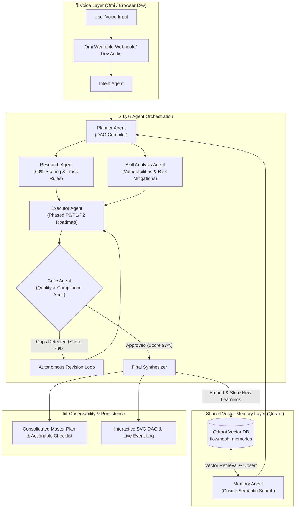

# FlowMesh AI
> **"Speak once. Let AI coordinate the work."**

An autonomous collaborative multi-agent workflow platform built for the official hackathon track: **Collaborative Multi-Agent Workflows** at *"Stop Prompting. The Dawn of the Autonomous AI Builder"*.

FlowMesh AI eliminates conversational prompting ping-pong by transforming a single, natural voice instruction into an observable, self-correcting team of specialized autonomous agents backed by **Qdrant** vector memory, **Lyzr** orchestration, and **Omi** wearable audio streams.

---

## 🏆 Hackathon Track Alignment

- **Official Track:** Collaborative Multi-Agent Workflows
- **Official Track Definition:** *"Voice-triggered execution pipelines where specialized agents coordinate using a shared vector memory layer."*
- **Judging Focus:** Working software and observable agentic workflows weigh **60%+ of the score**.
- **Mandatory Integrations:** **Omi** (Voice Wearable/API) + **Qdrant** (Vector Database) + **Lyzr** (Agent Studio Orchestrator).
- **Format:** Solo entry. Max 5-minute video demonstration. Submission portal: `app.hidevs.xyz`.

---

## 💡 The Problem vs The Solution

### The Chatbot Fallacy
Today's "AI wrappers" require users to repeatedly prompt, copy-paste outputs between different windows, manually formulate research queries, remind models of past mistakes, and act as a human router:
> *"Now search this..."* → *"Now remember what I said last week..."* → *"Now make a plan..."* → *"Wait, you forgot the 5-minute video limit, please revise..."*

### The FlowMesh Paradigm
**Speak once. Delegated autonomy.**
A user states their overarching goal:
> *"Help me prepare for my upcoming AI hackathon. Remember my previous project experience, research what I need to prepare, identify my weak areas, create a prioritized preparation plan, and check whether the plan covers everything."*

FlowMesh AI autonomously:
1. Captures speech and extracts structured intent and constraints.
2. Queries **Qdrant** vector memory for historical lessons and pitfalls.
3. Constructs an execution DAG via **Lyzr** Multi-Agent Orchestrator.
4. Fans out in parallel to specialized **Research** and **Capability Analysis** agents.
5. Synthesizes an initial draft roadmap with prioritized P0/P1/P2 milestones via the **Executor Agent**.
6. Audits the draft using a **Critic Agent** (`Draft -> Critic -> Revision -> Approved`).
7. Self-corrects detected omissions in real-time.
8. Consolidates final deliverables and embeds new learnings back into **Qdrant** vector storage.

---

## 🏛️ System Architecture



---

## 🤖 The 7 Specialized Agents

Each agent has a concrete, segregated responsibility:

| Agent | Name | Role & Responsibility |
|---|---|---|
| **1. Intent Agent** | `FlowMesh-Intent-Analyst` | Deconstructs unstructured voice into goals, constraints, domain, complexity, and priority. |
| **2. Memory Agent** | `FlowMesh-Qdrant-Context-Synthesizer` | Conducts semantic vector search over Qdrant, retrieving historical project experiences, preferences, and pitfall patterns. |
| **3. Planner Agent** | `FlowMesh-DAG-Orchestrator` | Compiles dependency DAG, identifying sequential bottlenecks vs tasks that can execute concurrently. |
| **4. Research Agent** | `FlowMesh-Domain-Researcher` | Analyzes track specifications, official hackathon judging weights (60%+ software & observability), and solo rules. |
| **5. Analysis Agent** | `FlowMesh-Capability-Assessor` | Evaluates user weaknesses (e.g., historical demo video length overflow) and formulates mitigation guardrails. |
| **6. Executor Agent** | `FlowMesh-Action-Planner` | Synthesizes research and memory findings into a 4-phase P0/P1/P2 master implementation roadmap. |
| **7. Critic Agent** | `FlowMesh-Quality-Verifier` | Evaluates executor drafts. Issues revision directives if gaps are detected, creating a genuine **Draft → Critic → Revision → Approved** cycle. |
| **8. Synthesizer Agent** | `FlowMesh-Final-Consolidator` | Consolidates all agent deliverables and embeds newly discovered insights back into Qdrant vector memory. |

---

## 🔗 The Mandatory Trinity Integrations

### 1. Omi Integration (`/lib/omi/`, `/api/omi/`)
- **Webhook Endpoint:** `/api/omi/webhook` handles Omi wearable memory triggers, real-time speech segments, and device heartbeats.
- **Truthful Telemetry:** If an active Omi webhook or `OMI_API_KEY` is present, displays **"Omi Connected"** with battery level and device ID. When operating locally without wearable hardware, it honestly displays **"Browser Voice — Development Mode"** (never faking hardware status).

### 2. Qdrant Integration (`/lib/qdrant/`, `/api/memory/`)
- **SDK:** Official `@qdrant/js-client-rest` client with `collectionExists`, `createCollection`, `upsert`, and `query` methods.
- **Collection:** `flowmesh_memories` with 768-dimensional normalized vectors and cosine distance indexing.
- **Payload Schema:** `memory_id`, `content`, `category`, `importance`, `source`, `timestamp`, `tags`.
- **Memory Explorer:** A visual UI allowing judges to browse stored vectors, perform live semantic similarity queries, and add new memories.

### 3. Lyzr Integration (`/lib/lyzr/`)
- **REST Client:** Targets production Lyzr Agent Studio v3 endpoints (`https://agent-prod.studio.lyzr.ai/v3/`).
- **Agent Factory:** Manages individual specialized agents with custom system instructions and roles.
- **Autonomous Multi-Agent Runner:** Coordinates parallel fan-outs (`Promise.all` across Research and Analysis) and orchestrates the Critic revision loop.

---

## 🛡️ Human-in-the-Loop & Governance

FlowMesh AI provides a dedicated **Human Control Bar**:
- **Pause / Resume Workflow:** Instantly halt execution between agent handoffs.
- **Retry Stage:** Re-run any individual agent if external dependencies stall.
- **Cancel:** Graceful workflow termination.
- **Approve Consequential Action:** Requires operator verification before newly synthesized memories are committed to the vector database.

---

## 🚀 Getting Started

### Prerequisites
- Node.js 18+ (tested on Node v24.19.0)
- npm 9+

### 1. Clone & Install
```bash
git clone https://github.com/your-username/flowmesh-ai.git
cd flowmesh-ai
npm install
```

### 2. Configure Environment Variables
Copy `.env.example` to `.env.local`:
```bash
cp .env.example .env.local
```

Populate the required credentials:
```ini
# Lyzr Agent Studio API
LYZR_API_KEY=your_lyzr_api_key_here

# Qdrant Vector Database (Cloud or Local http://localhost:6333)
QDRANT_URL=https://your-cluster.cloud.qdrant.io:6333
QDRANT_API_KEY=your_qdrant_api_key_here
QDRANT_COLLECTION_NAME=flowmesh_memories

# Omi Wearable / Developer API
OMI_API_KEY=your_omi_api_key_here
OMI_WEBHOOK_SECRET=your_omi_webhook_secret_here

# AI Model Provider (Used for embeddings and fallback orchestration)
GEMINI_API_KEY=your_gemini_api_key_here
```

### 3. Run Development Server
```bash
npm run dev
```
Open [http://localhost:3000](http://localhost:3000) in your browser.

### 4. Build for Production
```bash
npm run build
npm start
```

---

## 🎥 Hackathon Demo Walkthrough (< 5 Minutes)

1. **Observe Initial Telemetry:** Check top-bar status badges (`Browser Voice — Dev Mode`, `Qdrant Local Standby` or `Qdrant Cloud`, `Lyzr Orchestrator`).
2. **Review Initial Vector Memory:** Click **Memory Explorer** tab. Note pre-indexed memories:
   - *"User has participated in 3 AI hackathons; struggled most with demo time management (exceeded 5 min limit in 2025)."*
   - *"Identified Weak Area: Frontend visual observability for multi-agent DAG execution."*
3. **Execute Single Voice Request:** Click **Official Hackathon Demo** or speak:
   > *"Help me prepare for my upcoming AI hackathon. Remember my previous project experience, research what I need to prepare, identify my weak areas, create a prioritized preparation plan, and check whether the plan covers everything."*
4. **Watch Observable DAG Transitions:**
   - Intent Agent parses goals and constraints.
   - Memory Agent retrieves past pitfall vectors from Qdrant.
   - Planner Agent establishes DAG and triggers parallel fan-out.
   - Research & Analysis agents execute concurrently.
   - Executor Agent drafts Phase 1–4 roadmap.
   - **Critic Agent triggers Revision:** Detects unmitigated 5-minute video overflow risk (Score 79/100).
   - **Executor revises plan:** Embeds explicit 4:30 rehearsal timecode marks.
   - **Critic approves:** Score rises to 97/100 (`Draft -> Critic -> Revision -> Approved`).
5. **Inspect Live Deliverable:** Review the synthesized roadmap, toggle checklist items, export to Markdown, and verify that new learnings have been automatically persisted back to Qdrant.

---

## 📦 Project Structure

```
├── app/
│   ├── api/
│   │   ├── health/route.ts          # System trinity health checks
│   │   ├── memory/
│   │   │   ├── list/route.ts        # Qdrant memory list
│   │   │   ├── search/route.ts      # Qdrant semantic cosine search
│   │   │   └── store/route.ts       # Qdrant vector upsert
│   │   ├── omi/
│   │   │   ├── status/route.ts      # Omi hardware telemetry
│   │   │   └── webhook/route.ts     # Real-time Omi webhook receiver
│   │   ├── voice/transcribe/route.ts# Audio transcription route
│   │   └── workflow/run/route.ts    # Multi-agent orchestrator route
│   ├── globals.css                  # Modern glassmorphism & DAG animations
│   ├── layout.tsx                   # Dark mode root layout
│   └── page.tsx                     # Main FlowMesh dashboard
├── components/
│   └── dashboard/
│       ├── AgentGraphView.tsx       # Interactive animated SVG DAG
│       ├── AgentInspectorModal.tsx  # Telemetry inspector drawer
│       ├── ArchitectureView.tsx     # System specification & compliance
│       ├── FinalResultView.tsx      # Consolidated roadmap & checklist
│       ├── Header.tsx               # System badges & tab navigation
│       ├── HumanControlBar.tsx      # Pause, resume, retry, approve
│       ├── LiveEventLog.tsx         # Real-time timestamped event stream
│       ├── MemoryExplorer.tsx       # Qdrant vector browser & query UI
│       └── VoiceInputHero.tsx       # Speech capture & audio waveform
├── lib/
│   ├── agents/                      # 7 Specialized agents & LLM runner
│   ├── lyzr/                        # Lyzr Studio client & orchestrator
│   ├── omi/                         # Omi webhook & device client
│   └── qdrant/                      # Qdrant client, store & embeddings
├── types/                           # Strict TypeScript interfaces
├── .env.example                     # Environment template
└── README.md                        # Documentation
```

---

## 📜 License & Credits

Built with precision for the **"Stop Prompting. The Dawn of the Autonomous AI Builder"** Hackathon (Submission deadline: October 13, 2026).
- **Track:** Collaborative Multi-Agent Workflows
- **Powered by:** Omi, Qdrant, Lyzr
